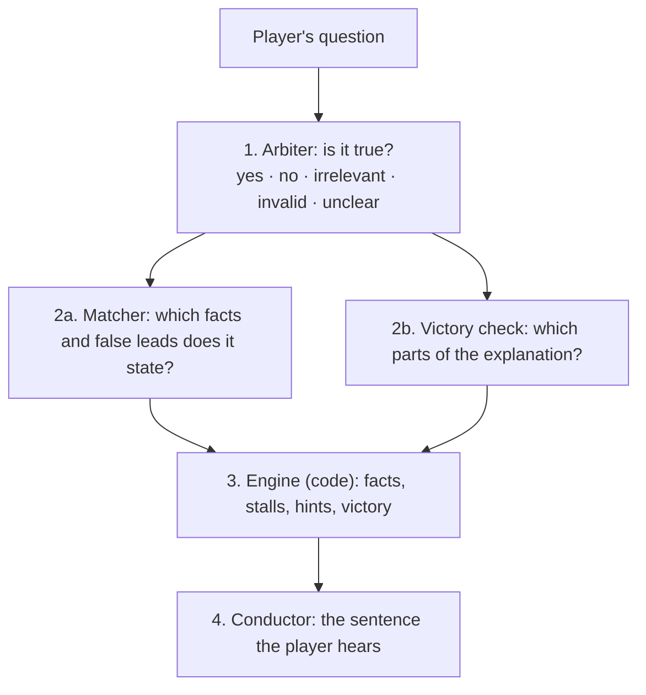

# Lateral Thinking Riddle

**A voice mystery game where a chain of LLMs plays the narrator, and code keeps it honest.**

[](https://github.com/Schiruzz/lateral-thinking-riddle/actions/workflows/tests.yml)

**[Play it](https://lateral-thinking-riddle-272762813139.europe-west8.run.app)** (Italian, three riddles) ·
**[Read the case study](docs/case-study.md)**

You hear a strange situation and ask yes/no questions out loud. The narrator answers, teases you,
and offers a hint only when you are truly stuck. Every fact you uncover lights a star; every false
lead you rule out stays in the sky as a dim red dwarf. Solve the story and the constellation becomes
the shape of the truth and takes its name.

| First prototype: one judge, a clue board | Now: a chain of models, the sky as the board |
|---|---|
|  |  |

The first prototype is kept at the tag [`prototype`](https://github.com/Schiruzz/lateral-thinking-riddle/tree/prototype).

## Quick start

```bash
pip install -r requirements.txt
python -m pytest -q                     # fast checks, no API calls
uvicorn riddle.server:app --reload      # then open http://localhost:8000
```

The models run on Vertex AI (`gemini-3.5-flash-lite`). Set `GOOGLE_CLOUD_PROJECT` and
`GCP_SA_KEY` (the JSON key of a service account with the Vertex AI User role).
Deploy: `gcloud run deploy lateral-thinking-riddle --source . --region europe-west8`.

## How a turn works

The models understand and phrase; the code decides.



1. **Arbiter**: the only model that reads the solution; it gives one of five answers.
2. **Matcher and victory check**, in parallel: which facts the question uncovered and which false
   leads it ruled out, and which parts of the final explanation it contains. A verifier
   double-checks the key facts.
3. **Engine**: plain code. It lights facts, counts stalls, offers hints, relaunches a partial
   explanation with a "why?", and decides the victory.
4. **Conductor**: writes the spoken sentence without ever seeing the solution. Code rejects an answer
   that adds words the player did not say, or a reaction that names a hidden fact.

## Adding a riddle

A riddle is data: a JSON card with the facts in order of play (step, leap, twist), what each one
presupposes, the false leads, the victory elements and the sky. Adding one means writing a card
and a line in `puzzles/index.json`, not touching prompts. The rules for writing a good card, each
learned from a real bug, are in **[docs/authoring.md](docs/authoring.md)**; the mechanical ones
are checked by the tests.

## Results

| | Cabin | Train | Seagull |
|---|---|---|---|
| How the card was written | after the prompts | after the prompts, frozen | tuning set |
| Arbiter: correct answers | 93% real players · 94% simulated | 95% simulated (241 questions) | 97% |
| Matcher: facts exactly right | 90–95% | not labelled | 88% |
| Conductor: lies in simulated turns | 0 in 189 | — | — |
| Median turn | 2.4 s | | |

The cabin and the train are the generality measure: their cards were written after the prompts and
judged with them frozen. On the train the arbiter scored 95% at the first run; one generic rule found
there (an omission makes "did she do it?" false) brought it to 96% without lowering the other two.
The seagull card was corrected on its own test questions, so its numbers are development numbers.
The full story is in the **[case study](docs/case-study.md)**.

## Known limits

- **A question that guesses the mechanism lights most of the story at once.** "Ha dimenticato di
  spostare l'orologio di casa?" answered yes lights eight facts of the train: the player has
  understood, but skips the discovery step by step.
- **The same person wrote the cards and reviewed the labels**, and most test questions come from
  simulated players. Real playtests so far are small.
- **Italian only.** The code and the prompts are in English; the cards and the conductor's lines
  are not translated yet.
- **Games live in memory**, so the server runs as a single instance.

## Repository

```
riddle/     judge.py (arbiter, matcher, verifier) · engine.py · conductor.py · play.py (one turn)
            schema.py (riddle cards) · server.py
            evaluate.py · simulate.py · labeler.py · playtest_labels.py (measuring)
puzzles/    one folder per riddle: the card and its labelled test questions; index.json the levels
static/     playtest.html (the page), sky.js (the sky), figures.js (the constellations)
docs/       case-study.md · authoring.md
tests/      fast checks with no API calls
```