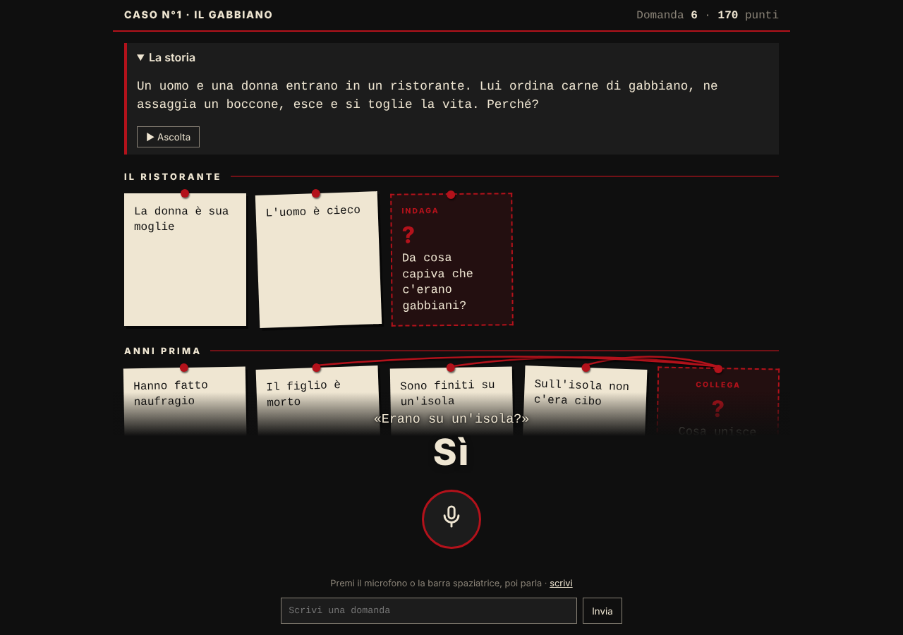
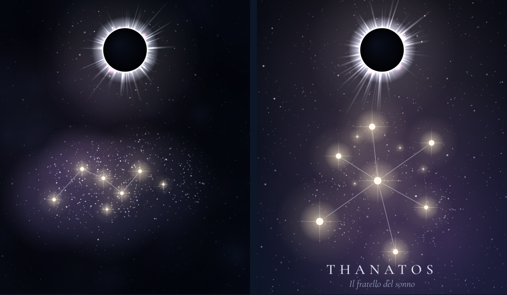
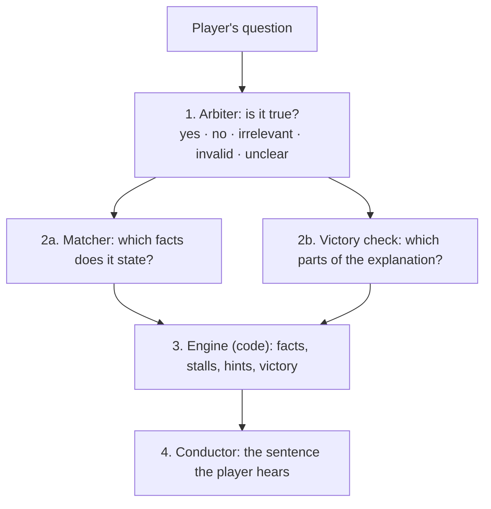

# Lateral Thinking Riddle

**A voice mystery game where a chain of LLMs plays the narrator, and code keeps it honest.**

[](https://github.com/Schiruzz/lateral-thinking-riddle/actions/workflows/tests.yml)


**[Play it](https://lateral-thinking-riddle-272762813139.europe-west8.run.app/playtest)** (Italian; English next) ·
**[Read the full case study](docs/case-study.md)**

You hear a strange situation and ask yes/no questions out loud. The narrator answers, teases you,
and offers a hint only when you are truly stuck. Every fact you uncover lights a star; solve the
story and the constellation becomes the shape of the truth and takes its name.

| First prototype: one judge, a clue board | Now: a chain of models, the sky as the board |
|---|---|
|  |  |

## Quick start

```bash
pip install -r requirements.txt
python -m pytest -q                     # fast checks, no API calls
uvicorn riddle.server:app --reload      # then open http://localhost:8000/playtest
```

The models run on Vertex AI (`gemini-3.5-flash-lite`). Set `GOOGLE_CLOUD_PROJECT` and
`GCP_SA_KEY` (the JSON key of a service account with the Vertex AI User role).
Deploy: `gcloud run deploy lateral-thinking-riddle --source . --region europe-west8`.

## How a turn works

The models understand and phrase; the code decides.



1. **Arbiter**: the only model that reads the solution; it gives one of five answers.
2. **Matcher and victory check**, in parallel: which facts of the riddle the question uncovered, and
   which parts of the final explanation it contains. A verifier double-checks the key facts.
3. **Engine**: plain code. It lights facts, counts stalls, offers hints, relaunches a partial
   explanation with a "why?", and decides the victory.
4. **Conductor**: writes the spoken sentence without ever seeing the solution. Code rejects an answer
   that adds words the player did not say, or a reaction that names a hidden fact.

A riddle is data: a card with facts (step, leap, twist), what each presupposes, false leads and
the victory elements. Adding a riddle means writing a card, not touching prompts.

## Results

| | Cabin (written after the prompts) | Seagull (tuning set) |
|---|---|---|
| Arbiter: correct answers | 93% real players · 94% simulated | 97% |
| Matcher: facts exactly right | 90–95% | 88% |
| Conductor: lies in 189 simulated turns | 0 | — |
| Median turn | 2.4 s | |

The cabin is the generality measure: its card was written after the prompts and judged with them frozen.
The seagull card was corrected on its own test questions, so its numbers are development numbers.
The first prototype, a single judge with a clue board, reached 99% answers and 90% cards on its own test set;
the full story of how it became this chain is in the **[case study](docs/case-study.md)**.

## Repository

```
riddle/     judge.py (arbiter, matcher, verifier) · engine.py · conductor.py · play.py (one turn)
            schema.py (riddle cards) · server.py · evaluate.py · simulate.py · labeler.py
puzzles/    one folder per riddle: the card and its labelled test questions
static/     playtest.html, sky.js (the sky), figures.js (the constellations)
tests/      fast checks with no API calls
```

`game.py`, `puzzle.py` and the page at `/` are the first prototype, kept for comparison.
